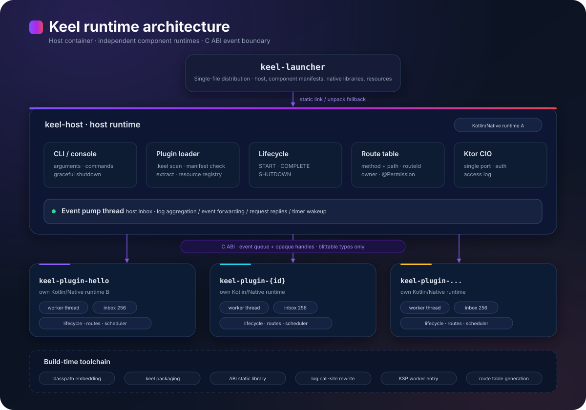
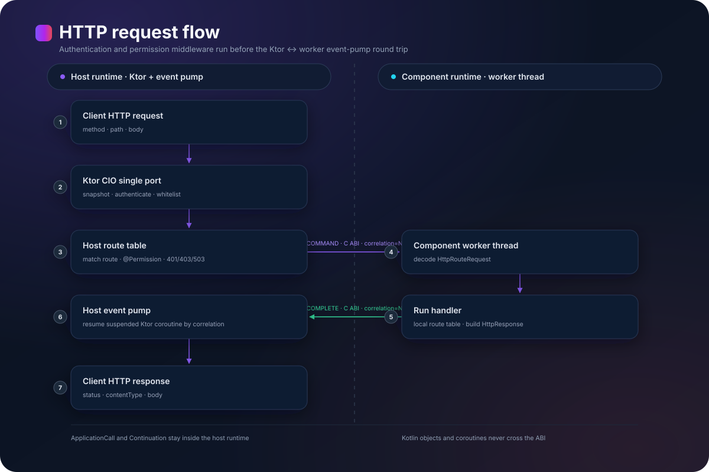
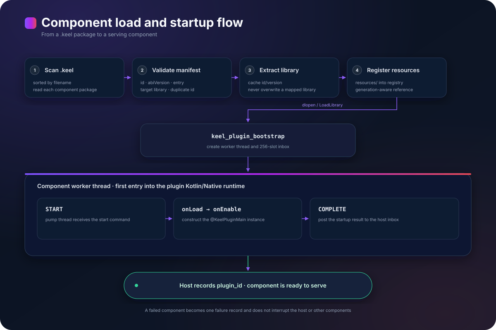

<div align="center">


# Keel

**A modular web framework for Kotlin/Native**

Componentized plug-in is the core capability: components are built independently, dynamically loaded or unloaded, and hot-updated at runtime. The host manages lifecycle, routing, and runtime boundaries.

[中文](README.zh.md) · English

[Quick Start](#quick-start) · [Architecture](#architecture) · [Writing a Plugin](#writing-a-plugin) · [Build Tasks](#build-tasks) · [Further Reading](#further-reading)

[](https://kotlinlang.org)
[](https://kotlinlang.org/docs/native-overview.html)
[](https://ktor.io)
[](https://github.com/google/ksp)
[](https://gradle.org)
[](LICENSE)

</div>

- **Targets**: `mingwX64`, `linuxArm64`, and `linuxX64`. No JVM target.
- **Delivery**: one host executable plus a set of `.keel` plugin packages. The launcher variant assembles the host, plugins, and resources into a single executable.
- **Runtime model**: the host and every plugin each own a Kotlin/Native runtime. They communicate through C ABI event queues and opaque handles.
- **Build model**: every top-level directory is an independent Gradle build. The root build aggregates them through a composite build.

> Code style and hard constraints are documented in [AGENTS.md](AGENTS.md). Phase goals are in [doc/roadmap.md](doc/roadmap.md). Third-party licenses are listed in [THIRD-PARTY-NOTICES.md](THIRD-PARTY-NOTICES.md).

## Design Goals

Keel is built around a componentized plug-in model. Components ship as independent deployment units and can be added, removed, and hot-updated at runtime. Kotlin/Native has no JVM class loader, dynamic libraries cannot be unloaded safely, and Kotlin objects or coroutines cannot cross library boundaries. Keel treats these facts as design premises:

1. **Separate container from business logic**: the host owns ports, routing, lifecycle, context, scheduling, and logging. Plugins implement business capabilities only.
2. **Deliver plugins independently**: each plugin produces a `.keel` package with a manifest, per-target native libraries, and resources. It can be installed, enabled, disabled, and upgraded on its own.
3. **Make boundaries explicit**: only fixed-width integers, pointers, C structs, and plain C function pointers cross a runtime boundary. Asynchronous capabilities degrade into event delivery and callback notification.
4. **Keep failures attributable**: a failed load, start, or request is isolated to one plugin. Error chains preserve creation and throw sites across runtimes.
5. **Generate code at build time**: route tables and worker entries are produced during the build. The runtime does not depend on reflection.

## Features

**Host and lifecycle**

- Scans a plugin directory, validates manifests, extracts native libraries, registers resources, and starts plugins
- Starts plugins in `requires` dependency order, stops them in reverse, and refuses a disable that would break a dependent
- Isolates a failed plugin as one load record without interrupting the host or other plugins
- Provides console commands to list, inspect, enable, disable, install, and remove plugins
- Stops HTTP first, then sends `SHUTDOWN` to each plugin, and finally drains the inbox during graceful shutdown
- Spawns a watchdog process and installs a crash handler to preserve evidence and write a report

**Cross-runtime communication**

- Each plugin owns a dedicated event pump thread and a bounded inbox
- Events carry `kind`, `source`, `target`, `correlation`, `subject`, `status`, and payload
- The host sends a `COMMAND` request; the plugin replies with `COMPLETE` and the same `correlation`
- The sender allocates the payload and attaches a release function; the receiver copies the payload and calls release
- Handles are slots in a reference-count table. When the count reaches zero, a `DISPOSE` event is delivered to the owner
- Plugins can post notifications or issue correlated requests to the host (permission catalog, config, storage, cache invalidation)

**Web service**

- The host owns the Ktor CIO engine and the port. Plugins never create a server.
- Plugins register route descriptors when enabled. The host matches method and path.
- Exact segments and `{name}` path parameters are supported
- Requests cross the boundary as an `HttpRequest` snapshot. Responses return as `HttpRouteResponse`
- Annotation controllers (`@Controller`, `@GET`, and friends) are generated at build time; the host enforces route permissions before dispatch
- Authentication and authorization come from `authn` / `authz` plugin SPIs, with a short TTL cache and fail-closed 401 / 403 / 503
- Inbound and outbound HTTP logs share the unified log format with client address, status, latency, and truncated request and response bodies

**Configuration and storage**

- Mainline `application.yaml` and per-plugin `config/plugins/<id>.yaml` are read through `Config`; writes preserve comments and blank lines
- Each plugin gets an isolated storage namespace (`read` / `write` / `delete`) mediated by the host

**Resource layer**

- Resources inside `.keel` are not extracted. They are read randomly through the zip central directory.
- The resource layer provides a composite view that prefers the plugin package and falls back to the host
- Cross-plugin access exposes only opaque references with a generation number
- Reads through stale references fail immediately after unload

**Logging and diagnostics**

- `Log` is the unified logging facade with six levels and structured call sites
- The compiler plugin injects class name, file, line, package, and function during IR transformation
- Plugin logs are encoded as `LOG` events and rendered by the host
- Exception creation and throw sites are recorded in a side table and printed as `Created at`, `Throwed at`, and `Printed at`
- `--inspect` reads a plugin manifest and resource entries and verifies that reads fail after unload

**Build toolchain**

- `moe.lolosia.keel.classpath` merges resources and embeds them into an executable
- `moe.lolosia.keel.plugin` packages `.keel` files and applies the ABI, logger, and KSP plugins
- `moe.lolosia.keel.abi` extracts the C ABI static library and injects linker options
- `moe.lolosia.keel.logger` attaches the log compiler plugin to Kotlin/Native compilation
- `moe.lolosia.keel.publish` registers a private Maven repository
- `keel-plugin-ksp` generates the worker entry from `@KeelPluginMain`

## Architecture

### Overview

<p align="center">
  
</p>

### Component responsibilities

| Component | Responsibility |
| --- | --- |
| `keel-api` | Plugin contract: lifecycle, context, routing, scheduling, logging, events, and messaging |
| `keel-host` | Host: plugin loading, lifecycle, event pump, Ktor engine, route table, console, and shutdown |
| `keel-launcher` | Single-file distribution entry: statically links the host. Plugin assembly is still in progress. |
| `keel-abi` | C ABI headers and per-target static libraries: queues, events, bootstrap, console, and crash handling |
| `keel-classpath` | Read-only resource layer: zip, directory, prefix view, and streaming reads |
| `keel-classpath-full` | Host registry, generation-aware resource references, and cross-module proxies |
| `keel-plugin-*` | Business plugins. Each plugin is a top-level independent Gradle build. |
| `keel-*-gradle-plugin` | Build-time Gradle plugins: embedding, packaging, ABI injection, logger attachment, and publishing |
| `keel-router-ksp` | Route table code generator |
| `keel-plugin-ksp` | Plugin worker entry code generator |

### Runtime model

The host and every plugin are separate Kotlin/Native runtimes. The host opens a plugin library with `dlopen` or `LoadLibrary` and resolves only `keel_plugin_bootstrap` and the worker entry declared in the manifest. It never calls a Kotlin function exported by the plugin directly. `keel_plugin_bootstrap` is implemented in C. It creates the worker thread, inbox, and event pump. The worker thread enters the plugin runtime for the first time when it receives `START`, constructs the class annotated with `@KeelPluginMain`, and advances the lifecycle. Host threads and plugin threads therefore never enter each other's runtime.

The event pump thread is the only Kotlin execution entry for its plugin. The host posts events to the plugin inbox. The pump thread dequeues and dispatches them. When the plugin produces a result, it posts `COMPLETE` back to the host inbox. The host main thread drains the host inbox periodically and completes suspended requests by `correlation`. Both inboxes are fixed-size ring buffers with 256 slots. A full queue rejects the event instead of growing without bound.

### Lifecycle

| Phase | Executor | Behavior |
| --- | --- | --- |
| Scan | Host | Lists `.keel` files in the plugin directory in filename order |
| Validate | Host | Checks `id`, `abiVersion`, `entry`, the current target library entry, and duplicate ids |
| Extract | Host | Writes the native library to the cache directory under `id/version` |
| Register resources | Host | Registers the package `resources/` in the classpath registry |
| Load | Host | Calls `dlopen` or `LoadLibrary` and resolves bootstrap and entry symbols |
| Start | C and plugin worker | Bootstrap creates the thread and queue, posts `START`, and runs `onLoad` then `onEnable` |
| Serve | Plugin worker | Handles HTTP, console, scheduled tasks, and health-check events |
| Disable | Plugin worker and host | Plugin runs `onDisable` and clears its scheduler. Host removes the plugin routes. |
| Shutdown | Host | Stops HTTP, posts `SHUTDOWN` to each plugin, drains the inbox, and exits |

### Cross-runtime boundary

The only carrier across a boundary is the C ABI. [`keel_abi.h`](keel-abi/src/nativeCpp/keel_abi.h) is the single source of truth for struct layouts and exported symbols. The Kotlin side uses cinterop bindings. The C side implements queues, event release, bootstrap, and platform thread primitives. Every binary links its own copy of the static library, so queues and handle tables are isolated per binary.

| Invariant | Constraint |
| --- | --- |
| One runtime per thread | A thread may enter only one Kotlin/Native runtime |
| Host never calls plugins directly | The host resolves the entry address. Bootstrap calls it on the event pump thread. |
| Objects stay local | Kotlin objects remain in the owning runtime. The other side holds a handle and a local proxy. |
| Coroutines stay local | `suspend` is used only inside a runtime. Completion returns as an event. |
| Callbacks use identifiers | A numeric callback id is registered. Invocation posts an event and the owner dispatches it. |
| Payload ownership is explicit | The sender allocates the payload and attaches a release function. The receiver copies and releases it. |
| Hot paths use binary encoding | CBOR or Protobuf is the target format. The HTTP boundary currently uses JSON. |
| Unload does not reclaim address space | Unload stops the event pump and drops references. The process restart reclaims the library. |
| Missing capability means denial | Missing permissions, resources, or services return a failure instead of falling open. |

### Request flow

<p align="center">
  
</p>

The Ktor handler runs in a host coroutine. It does not call the plugin directly. It submits the request through `HostPump.request` and suspends. The pump thread posts the event and returns the reply. A `CompletableDeferred` completes the suspension. `ApplicationCall`, `Continuation`, and all Ktor context remain inside the host runtime.

### Plugin load flow

<p align="center">
  
</p>

### Resource and unload semantics

A `.keel` file is a zip package with a root `plugin.json`, per-target native libraries, and a `resources/` directory. Resources are never extracted. Both host and plugin read entries randomly through the central directory. The host maintains a `ClasspathRef` with a generation number for each plugin. When a plugin is unloaded, the generation becomes invalid and reads through old references throw `ClasspathNotFoundException`. Cross-plugin access returns only opaque references. The real package path never leaves the host.

Kotlin/Native runtimes cannot be unloaded safely. After `dlclose`, TLS and GC state can crash later. Unload therefore stops the event pump, removes routes, and releases resource references. The native library remains mapped until the process exits.

### Logging and diagnostics

`Log` is the unified logging facade. `moe.lolosia.keel.logger` rewrites `Log.info(...)` during IR transformation so the call carries its source site: class name, file, line, package, and function. Plugin logs are encoded as `LOG` events and rendered by the host with the same line format. When the terminal supports ANSI, level, module name, and source class name are colored. The module column uses the manifest `name` by default, and `plugin.json.color` can assign a truecolor to a plugin.

The same compiler plugin instruments exception construction and `throw`, recording creation and throw sites. The log renderer prints `Created at`, `Throwed at`, and `Printed at` after each exception header. Creation time and throw sites cross the runtime through `KeelErrorEntry`, and the host does not append carrier-only stack frames.

## Quick Start

### Requirements

- JDK 21 to run Gradle and KSP processors. The produced binaries do not require a JVM.
- The first build downloads the Kotlin/Native toolchain into `~/.konan`.
- Building `linuxArm64` or `linuxX64` on Windows requires WSL2 and the matching `objcopy`.
- `.keel` packaging and console plugin management need no additional services.

### Build the host and the example plugin

```powershell
gradlew :keel-host:linkDebugExecutableMingwX64
gradlew :keel-plugin-hello:keelPackage
```

Artifact locations:

```text
keel-host/build/bin/mingwX64/debugExecutable/keel-host.exe
keel-plugin-hello/build/keel/keel-plugin-hello-0.1.0-SNAPSHOT.keel
```

Build every independent build:

```powershell
gradlew buildAll
```

### Start the host

```powershell
.\keel-host\build\bin\mingwX64\debugExecutable\keel-host.exe `
    --plugins .\keel-plugin-hello\build\keel `
    --http=7180 `
    --serve
```

`--plugins` points to a directory containing `.keel` files. The cache directory defaults to `.cache` inside that directory. The host prints the startup banner, plugin load results, health-check results, and the HTTP listen address. Type `stop` in the console or press `Ctrl+C` to trigger a graceful shutdown.

### Smoke test

```powershell
curl.exe -s http://127.0.0.1:7180/healthz
curl.exe -s http://127.0.0.1:7180/ping
curl.exe -s http://127.0.0.1:7180/hello
curl.exe -s -X POST -H "Content-Type: application/json" --data '{"name":"keel","count":1}' http://127.0.0.1:7180/echo
```

Expected output:

```text
ok
ok
hello from keel plugin
{"name":"keel","count":1}
```

`/healthz` is answered by the host and does not touch a plugin. `/ping` performs a full event pump round trip: the host posts `PING`, the plugin replies with `COMPLETE`, and the host returns the HTTP response.

### Console commands

```text
help
plugins list
plugins info hello
plugins disable hello
plugins enable hello
plugins remove hello
stop
```

`help`, `stop`, and `plugins` are host commands. Other input is offered to plugins in enable order. A plugin returns `false` to let the next plugin handle the command.

### One-shot validation

```powershell
.\keel-host\build\bin\mingwX64\debugExecutable\keel-host.exe `
    --plugins .\keel-plugin-hello\build\keel `
    --once
```

`--once` exits after plugin startup and health checks. It is suitable for automation.

### Inspect a plugin package

```powershell
.\keel-host\build\bin\mingwX64\debugExecutable\keel-host.exe `
    --inspect .\keel-plugin-hello\build\keel\keel-plugin-hello-0.1.0-SNAPSHOT.keel
```

`--inspect` reads the manifest and resource entries and verifies that reads fail after unload.

## Writing a Plugin

### 1. Create an independent build

Create a top-level `keel-plugin-<id>/` directory with its own `settings.gradle.kts`, `build.gradle.kts`, sources, and resources. The plugin build must declare the build-time plugins it uses:

```kotlin
pluginManagement {
    includeBuild("../keel-plugin-gradle-plugin")
    includeBuild("../keel-abi-gradle-plugin")
    repositories {
        maven("https://maven.aliyun.com/repository/public")
        gradlePluginPortal()
        mavenCentral()
    }
}

dependencyResolutionManagement {
    repositories {
        maven("https://maven.aliyun.com/repository/public")
        mavenCentral()
    }
    versionCatalogs {
        create("libs") { from(files("../gradle/libs.versions.toml")) }
    }
}

rootProject.name = "keel-plugin-hello"
```

When developing inside this repository, also add the new directory to the `includeBuild` list in the root [`settings.gradle.kts`](settings.gradle.kts) so the root build can substitute Maven coordinates and aggregate tasks.

### 2. Configure the build script

```kotlin
plugins {
    alias(libs.plugins.kotlin.multiplatform)
    id("moe.lolosia.keel.plugin")
}

group = "moe.lolosia.keel.plugins"
version = libs.versions.keel.get()

keelPlugin {
    target("mingwX64")
}

kotlin {
    mingwX64 { binaries.sharedLib { baseName = "keel-plugin-hello" } }
    linuxArm64 { binaries.sharedLib { baseName = "keel-plugin-hello" } }
    linuxX64 { binaries.sharedLib { baseName = "keel-plugin-hello" } }

    sourceSets {
        commonMain.dependencies {
            api("moe.lolosia.keel:keel-api:${libs.versions.keel.get()}")
        }
    }
}
```

`moe.lolosia.keel.plugin` applies ABI injection, the logger compiler plugin, and KSP, and registers the `keelPackage` task. The plugin project only needs lifecycle code and `plugin.json`.

### 3. Write the plugin manifest

Place the manifest at `src/commonMain/resources/plugin.json`. Packaging copies it to the root of the `.keel` package:

```json
{
  "id": "hello",
  "name": "Hello Plugin",
  "color": "#FF8800",
  "version": "0.1.0",
  "abiVersion": 1,
  "entry": "keel_plugin_worker_main",
  "lib": {
    "mingwX64": "lib/mingwX64/keel_plugin_hello.dll"
  },
  "resources": "resources/",
  "requires": [],
  "authors": ["lolosia"],
  "description": "Minimal example plugin"
}
```

| Field | Required | Description |
| --- | --- | --- |
| `id` | Yes | Globally unique identifier. Lowercase dot-separated or hyphenated names are recommended. |
| `version` | Yes | Plugin version. Used in the cache directory layout. |
| `abiVersion` | Yes | Compatible host ABI major version. Currently `1`. |
| `entry` | Yes | Worker entry symbol generated by KSP. |
| `lib` | Yes | Target name to package-relative native library path. |
| `resources` | No | Resource prefix inside the package. Defaults to `resources/`. |
| `name` | No | Display name used in the log module column. |
| `color` | No | Truecolor for the plugin module column. Accepts `#RRGGBB` and `#RGB`. |
| `requires` | No | Required capability or plugin ids; drives topological start order and is validated before enable. |
| `authors` | No | Author list. |
| `sha256` | No | Checksum of the native library or package. Currently read but not verified. |

### 4. Implement the lifecycle

```kotlin
package moe.lolosia.keel.plugins.hello

import moe.lolosia.keel.api.*
import moe.lolosia.keel.api.annotation.KeelPluginMain
import moe.lolosia.keel.api.command.*
import moe.lolosia.keel.api.web.*

@KeelPluginMain
class HelloPlugin : Plugin {

    private lateinit var context: PluginContext

    override fun onLoad(context: PluginContext) {
        this.context = context
        context.routes.register(RouteDescriptor("GET", "/hello", "hello#hello")) { _, _ ->
            HttpResponse(body = ResponseBody.Text("hello from keel plugin"))
        }
        context.routes.register(RouteDescriptor("POST", "/echo", "hello#echo")) { request, _ ->
            HttpResponse(
                body = ResponseBody.Text(
                    text = request.body.decodeToString(),
                    contentType = "application/json; charset=utf-8",
                ),
            )
        }
        Log.info("loaded ${context.metadata.id}")
    }

    override fun onEnable() {
        Log.info("enabled")
        var ticks = 0
        var handle: TaskHandle? = null
        handle = context.scheduler.schedule(0, 1_000) {
            ticks++
            Log.info("tick $ticks")
            if (ticks == 3) handle?.cancel()
        }
    }

    override fun onDisable() {
        Log.info("disabled")
    }

    override fun onCommand(
        sender: CommandSender,
        command: Command,
        label: String,
        args: List<String>,
    ): Boolean {
        if (label != "hello") return false
        sender.sendMessage("hello ${args.joinToString(" ")}")
        return true
    }
}
```

A class annotated with `@KeelPluginMain` must implement `Plugin` and provide a no-argument constructor. KSP generates the fixed C entry `keel_plugin_worker_main`, which bootstrap calls on the event pump thread. No entry glue code is written by hand.

### 5. Package and install

```powershell
gradlew :keel-plugin-hello:keelPackage
```

Package layout:

```text
keel-plugin-hello-0.1.0-SNAPSHOT.keel
  plugin.json
  lib/mingwX64/keel_plugin_hello.dll
  resources/hello.txt
```

Place the `.keel` file in the directory passed to `--plugins`, or run:

```text
plugins install <keel path>
```

The host copies the package, assigns a `plugin_id`, and starts the plugin. A `plugin_id` is valid only inside the current process. Persistent identity always uses the manifest `id`.

### 6. Register routes

Routes are currently registered manually in `onLoad`:

```kotlin
context.routes.register(
    RouteDescriptor(
        method = "GET",
        path = "/user/{id}",
        routeId = "hello#user",
        permissions = listOf("hello.user.read"),
    ),
) { request, pathParameters ->
    val id = pathParameters["id"]
    HttpResponse(body = ResponseBody.Bytes(ByteArray(0)))
}
```

Route matching supports exact segments and `{name}` segments. Requests enter the plugin as an `HttpRequest` snapshot:

| Field | Description |
| --- | --- |
| `method` | HTTP method |
| `path` | Request path |
| `query` | Query parameters as lists |
| `headers` | Request headers |
| `body` | Raw request body bytes |
| `remoteAddress` | Client address. Not currently populated by the host. |
| `traceId` | Trace identifier. Not currently populated by the host. |

Responses use `HttpResponse`:

| Field | Description |
| --- | --- |
| `status` | HTTP status code |
| `headers` | Contract field for response headers. The current wire format does not carry them. |
| `body` | `ResponseBody.Empty`, `Text`, `Bytes`, or `Stream` |
| `envelope` | Ignored for `HttpResponse`: its body is written as-is. Generated controllers envelope plain business objects. |

Annotation controllers are generated by `keel-router-ksp`. The annotations are `@Controller`, `@GET`, `@POST`, `@PUT`, `@DELETE`, `@PATCH`, `@Path`, `@Query`, `@Header`, `@Body`, and `@Permission`. The processor generates the route table, parameter binding, JSON envelope, and permission nodes; manual `ctx.routes.register` remains available. Host dispatch enforces the declared `RouteDescriptor.permissions`.

### 7. Use the scheduler

```kotlin
val handle = context.scheduler.schedule(delayMillis = 100, periodMillis = 1_000) {
    Log.info("periodic task")
}
handle.cancel()
```

The scheduler is bound to the plugin worker thread. Delayed and periodic tasks run only on that thread. Cancellation does not wake the event pump early, so at most one extra tick may occur. Long-running work should be split into short tasks so the event pump remains responsive.

### 8. Read resources

`keel-classpath` can read a directory or a zip directly:

```kotlin
val classpath = classpathFromDirectory("src/commonMain/resources")
val text = classpath.read("hello.txt")?.decodeToString()
```

`ctx.classpath` is declared with the same read-only interface. Plugin-side reads of its own resources and cross-plugin remote reads are still being connected. The host registry, `ClasspathRef`, and generation invalidation are available for host resources and development-time validation.

### 9. Write logs

```kotlin
Log.info("plugin started")
Log.warn("configuration is missing")
Log.error("request failed", cause = exception)
```

`Log` calls are rewritten by the compiler plugin, so each line contains a class name and line number. `context.logger` remains as a compatibility entry and carries no call site. The plugin module column uses `plugin.json.name` and falls back to `id`.

## Build Toolchain

| Tool | Type | Purpose |
| --- | --- | --- |
| `moe.lolosia.keel.classpath` | Gradle plugin | Merges source-set resources into `classpath.zip` and embeds it through `windres` or `objcopy` |
| `moe.lolosia.keel.plugin` | Gradle plugin | Produces `.keel` packages and applies ABI, logger, and KSP |
| `moe.lolosia.keel.abi` | Gradle plugin | Extracts `libkeel_abi.a` and headers and injects linker options and export lists |
| `moe.lolosia.keel.logger` | Gradle plugin | Attaches the log compiler plugin to Kotlin/Native compilation |
| `moe.lolosia.keel.publish` | Gradle plugin | Registers a private Maven repository |
| `keel-plugin-ksp` | KSP processor | Generates `keel_plugin_worker_main` from `@KeelPluginMain` |
| `keel-router-ksp` | KSP processor | Generates route tables from controller annotations |

### Resource embedding

```kotlin
keelClasspath {
    target("mingwX64")
    compressed = false
    windows {
        productName = "Keel Modular Web Framework"
    }
}
```

Executables, dynamic libraries, and shared libraries use this path. Plugins do not use `classpath.zip`. Their resources ship inside the `.keel` package.

### Plugin packaging

```kotlin
keelPlugin {
    target("mingwX64")
    buildType = "RELEASE"
    autoAddClasspathFull = true
}
```

`buildType` selects the `DEBUG` or `RELEASE` native library. When `target` is empty, the plugin chooses `mingwX64`, `linuxArm64`, or `linuxX64` from the host platform.

### ABI injection

```kotlin
keelAbi {
    export("my_worker_entry")
}
```

The default exports are `keel_plugin_bootstrap`, `keel_plugin_shutdown`, and `keel_plugin_worker_main`. Additional exports are needed only for a custom worker entry name. On Windows, Kotlin `@CName` symbols do not enter the PE export table automatically, so packaging relies on the `.def` file generated by the ABI plugin.

### Log transformation

```kotlin
keelLogger {
    enabled = true
    exceptionTrace = true
}
```

`exceptionTrace` controls instrumentation of exception construction and `throw`. When disabled, logs no longer print creation and throw sites.

## Command Line

| Option | Description |
| --- | --- |
| `--plugins <dir>` | Scan the directory for `.keel` packages and start plugins |
| `--once` | Exit after startup and health checks |
| `--serve` | Stay resident until console `stop` or an interrupt signal |
| `--serve-ms=<n>` | Run for a fixed duration and then shut down gracefully |
| `--http=<port>` | Start Ktor CIO on the port |
| `--inspect <path>` | Inspect the manifest and resources of one `.keel` package |
| `--watchdog` | Internal watchdog entry. The host normally spawns it automatically. |

The second positional argument after `--plugins` is the cache directory. It defaults to `<plugin dir>/.cache`. Native libraries are stored under `<id>/<version>/`.

## Build Tasks

| Task | Description |
| --- | --- |
| `gradlew buildAll` | Build every independent Gradle build |
| `gradlew :keel-host:linkDebugExecutableMingwX64` | Build the Windows debug host |
| `gradlew :keel-host:linkReleaseExecutableLinuxArm64` | Build the arm64 release host |
| `gradlew :keel-host:linkReleaseExecutableLinuxX64` | Build the x64 release host |
| `gradlew :keel-launcher:linkReleaseExecutableMingwX64` | Build the Windows single-file launcher entry |
| `gradlew :keel-plugin-hello:keelPackage` | Package the example plugin |
| `gradlew :keel-abi:keelAbiPackage` | Package ABI headers and static libraries |
| `gradlew :keel-api:build` | Build the plugin contract |
| `gradlew :keel-plugin-hello:build` | Verify that a consumer compiles |

When building one directory on its own, cross-directory dependencies come from Maven coordinates. Local verification can pass `--include-build=../keel-api` and similar options to provide dependent builds. The root composite build performs the substitution automatically.

### Publishing

Publish addresses and credentials are stored only in the local `local.properties`:

```properties
keel.repo=http://<maven-host>/repository/keel
keel.username=<user>
keel.password=<password>
```

Publish order:

```text
build plugins and KSP processors
  → keel-abi
  → keel-classpath
  → keel-api
  → keel-classpath-full
  → keel-host
  → business plugins
  → keel-launcher
```

Each build-time tool configures its own publishing repository in its `build.gradle.kts`. Business plugins apply `moe.lolosia.keel.publish` instead of writing `publishing {}` by hand. After changing `keel-api`, every consumer must be recompiled.

## Deployment

The runtime needs only the host executable and a plugin directory:

```text
/opt/keel/
  keel-host
  plugins/
    hello-0.1.0.keel
  work/
```

Run with `--http=<port> --plugins <dir> --serve` for a resident service. The host does not require a JVM or a Kotlin runtime on the target machine. To stop it, send an interrupt signal or type `stop` in the console. The host stops HTTP first and then disables each plugin.

A systemd unit can use the host executable as `ExecStart` with the deployment directory as its working directory. Container deployments mount the host, the plugin directory, and the exposed port. Startup failures, plugin load failures, and request errors are written to daily log files under `work/log` in the working directory.

## Repository Layout

```text
keel/
├── build.gradle.kts                 root build, aggregation only
├── settings.gradle.kts              composite build list
├── gradle/libs.versions.toml        single version source
├── keel-abi/                        C ABI headers, event queues, bootstrap, static libraries
├── keel-abi-gradle-plugin/          ABI static library injection
├── keel-api/                        plugin contract and plugin-side runtime
├── keel-classpath/                  read-only resource layer
├── keel-classpath-full/             host registry and cross-module resource references
├── keel-classpath-gradle-plugin/    resource merge and executable embedding
├── keel-host/                       host
├── keel-launcher/                   single-file distribution entry
├── keel-logger-compiler-plugin/     log call-site IR transformation
├── keel-logger-gradle-plugin/       logger compiler plugin attachment
├── keel-plugin-gradle-plugin/       .keel packaging
├── keel-plugin-hello/               example plugin
├── keel-plugin-ksp/                 worker entry generation
├── keel-publish-gradle-plugin/      publishing repository registration
├── keel-router-ksp/                 route table generation
└── doc/                             design documents and plans
```

Every top-level directory is an independent Gradle build. Each directory can be cloned and built on its own, with cross-directory dependencies resolved from Maven. The dependency direction is `keel-api ← keel-host ← keel-launcher` and `keel-api ← keel-plugin-*`. Build-time tools are independent of the runtime. No directory may read source files from a sibling directory. Cross-directory use goes through Maven coordinates or build artifacts.

## Current Status

Keel is at `0.1.0-SNAPSHOT`. The host, C ABI, plugin loading, HTTP routing, logging, configuration, authentication, storage, and packaging pipeline are runnable. The following table tracks each capability.

| Capability | Status | Notes |
| --- | --- | --- |
| Plugin scan, validation, loading, enable and disable | Available | `.keel` directory, library cache, and failure isolation |
| C ABI event pump and request replies | Available | Queues, `correlation`, health checks, logs, HTTP, and console |
| Cross-runtime handles and callbacks | Contract defined | Host handle table and `CallbackRegistry` are not connected |
| Plugin dependency ordering | Available | Topological start, reverse-order stop, and dependency validation for `requires` |
| Single-port HTTP and manual routes | Available | `ctx.routes.register`, path parameters, and JSON wire format |
| Scheduler | Available | Delay, period, and cancellation on the worker thread |
| Log call sites and exception diagnostics | Available | IR transformation, colors, creation and throw sites |
| `.keel` packaging and console plugin management | Available | `keelPackage`, `plugins` commands, and `--inspect` |
| Resource layer | Partially available | Host registry is available. Plugin-side resource reads are not connected. |
| Cross-module service calls | Available | `@ModuleService` codegen plus Host forwarding with CBOR payloads |
| Configuration read and write | Available | Host YAML with comment-preserving writes; `ctx.config` and `ctx.server.config` |
| Plugin storage | Available | Per-plugin `read` / `write` / `delete` under `<workDir>/plugins/<id>/` |
| Annotation route generation | Available | `@Controller` / `@GET` etc. generate `KeelPluginRoutes` |
| Permission checks | Available | Host middleware with `authn` / `authz` SPI, 401 / 403 / 503 |
| JSON envelope and response headers | Partially available | Generated controllers wrap JSON in the envelope; `HttpResponse.headers` is not on the wire yet |
| Streaming responses | Contract defined | `ResponseBody.Stream` is not connected to HTTP dispatch |
| Single-file plugin embedding | Entry available | `keel-launcher` currently forwards to the host entry |
| Publish artifact packaging | Not implemented | `moe.lolosia.keel.publish` registers the repository only. Per-target archiving and publishing are not implemented. |
| Automated tests | Not connected | Validation uses compilation, `--inspect`, and startup smoke tests |

## Further Reading

| Document | Content |
| --- | --- |
| [AGENTS.md](AGENTS.md) | Code style, build boundaries, and hard constraints |
| [doc/roadmap.md](doc/roadmap.md) | DEMO, P0, P1, and P2 goals and acceptance criteria |
| [doc/abi-design.md](doc/abi-design.md) | C ABI, workers, handles, event pump, and memory rules |
| [doc/web-design.md](doc/web-design.md) | Single-port routing, request context, middleware, and streaming |
| [doc/classpath-design.md](doc/classpath-design.md) | Resource namespaces, `.keel` packages, and unload semantics |
| [doc/config-design.md](doc/config-design.md) | Configuration layering, comment preservation, and plugin isolation |
| [doc/authz-design.md](doc/authz-design.md) | Permission contract and RBAC plugin boundary |
| [doc/codegen-design.md](doc/codegen-design.md) | Zero-boilerplate module access and code generation |
| [doc/capability-design.md](doc/capability-design.md) | Capability plugins and stable C ABI |
| [doc/前序讨论.md](doc/前序讨论.md) | Feasibility discussion, hard constraints, and risks |

## License

Keel is released under the [MIT License](LICENSE). Third-party component names, versions, licenses, and usage are listed in [THIRD-PARTY-NOTICES.md](THIRD-PARTY-NOTICES.md).
